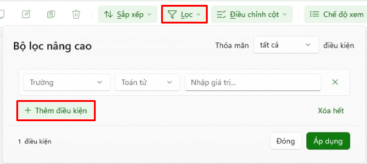

# Chức năng Chứng từ

## <mark style="color:$primary;">Menu các chức năng trong thanh công cụ</mark>

<figure><figcaption></figcaption></figure>

\- Thoát về màn hình chính (Tổng quan) (<mark style="color:red;">**Phím tắt**</mark> <mark style="color:red;">**ESC**</mark>)

\- Hiển thị danh sách chứng từ, và các chức năng chính:

#### Thao tác: (<mark style="color:red;">**Phím tắt F1**</mark>) mở giao diện màn hình các chức năng thao tác chứng từ.

<figure><figcaption></figcaption></figure>

\+ [Nhập CT mới](readme/chuc-nang-them-moi-chung-tu/) (<mark style="color:red;">**Phím tắt Alt + N**</mark>): Nhập mới một chứng từ vào hệ thống.

\+ [Nạp dữ liệu](readme/chuc-nang-nap-du-lieu/) (<mark style="color:red;">**Phím tắt Alt + I**</mark>): Import file danh sách chứng từ vào hệ thống.

\+ Copy (<mark style="color:red;">**Phím tắt Ctrl + C**</mark>): Copy toàn bộ thông tin của một chứng từ đã chọn

\+ Chỉnh sửa (<mark style="color:red;">**Phím tắt Chọn dữ liệu + Enter**</mark>): Dùng để xem chi tiết chứng từ, hoặc chỉnh sửa các thông tin của chứng từ.


_<mark style="color:$danger;">Lưu ý: chứng từ trong một tháng, khi tháng đó kết thúc thì thông tin các chứng từ đó sẽ được khóa lại không thể chỉnh sửa.</mark>_


\+ Tạo bản sao chứng từ đang chọn (<mark style="color:red;">**Phím tắt Ctrl + Shift + C**</mark>): Chọn một chứng từ và copy ra một bản chứng từ đã chọn.

\+ Xóa (<mark style="color:red;">**Phím tắt Alt + X**</mark>): Chọn một chứng từ để xóa chứng từ đó.

\+ Ghi sổ/Bỏ ghi sổ: (<mark style="color:red;">**Phím tắt Alt + G**</mark>): sử dụng để chính thức ghi nhận các chứng từ đã được kiểm tra vào hệ thống sổ kế toán. Sau khi ghi sổ, hệ thống tự động cập nhật số liệu vào các tài khoản, công nợ, kho và các báo cáo liên quan, đảm bảo số liệu kế toán được phản ánh đầy đủ và kịp thời.


_<mark style="color:$danger;">Lưu ý: là điều kiện cần để sử dụng chức năng kết chuyển toàn kỳ bên dưới, trường hợp chứng từ đã ghi sổ,cho phép thực hiện chỉnh sửa chứng từ và lưu lại, trạng thái chứng từ sẽ chuyển về thành trạng thái “NHÁP” và cần thực hiện ghi sổ lại.</mark>_


·   Ghi sổ (<mark style="color:red;">**Phím tắt Enter**</mark>): thực hiện xác nhận ghi sổ các chứng từ đã chọn.

·   Hủy (<mark style="color:red;">**Phím tắt ESC**</mark>): hủy thao tác ghi sổ.

\+ Sắp xếp (<mark style="color:red;">**Phím tắt Alt + S**</mark>): Chức năng Sắp xếp dùng để thay đổi thứ tự hiển thị dữ liệu trên danh sách theo một hoặc nhiều tiêu chí, giúp dễ dàng tra cứu, kiểm tra và đối chiếu chứng từ.

<figure><figcaption></figcaption></figure>

\+ Lọc (<mark style="color:red;">**Phím tắt Alt + L**</mark>): Chức năng Lọc dùng để tìm và hiển thị các chứng từ hoặc dữ liệu đáp ứng một hoặc nhiều điều kiện lọc, giúp nhanh chóng tra cứu thông tin cần thiết trên danh sách.

<figure><figcaption></figcaption></figure>

\+ Chỉnh cột hiển thị (<mark style="color:red;">**Phím tắt Alt + D**</mark>): chức năng giúp tùy chỉnh cách hiển thị các cột dữ liệu trên màn hình danh sách, bao gồm sắp xếp thứ tự cột và ẩn/hiện cột theo nhu cầu sử dụng.

\+ Chế độ xem (<mark style="color:red;">**Phím tắt Alt + V**</mark>): chức năng dùng để thay đổi cách hiển thị danh sách dữ liệu trên màn hình. Tùy theo nhu cầu làm việc, người dùng có thể lựa chọn hiển thị thông tin ở dạng rút gọn hoặc đầy đủ, đồng thời bật/tắt khung xem trước để theo dõi nội dung nhanh hơn.

<figure><figcaption></figcaption></figure>

\+ Xem chi tiết nhanh một chứng từ (<mark style="color:red;">**Phím tắt Alt + Enter**</mark>): Chọn một chứng từ và mở view xem thông tin chi tiết chứng từ đó, chỉ xem không chỉnh sửa được.

\+ Tick chọn,bỏ chọn hết (<mark style="color:red;">**Phím tắt Ctrl + A**</mark>): thực hiện chọn hoặc bỏ chọn tất cả chứng từ trong danh sách

\+ Chạy sổ (<mark style="color:red;">**Phím tắt Alt + Y)**</mark>:

\+ CT kết chuyển (<mark style="color:red;">**Phím tắt Alt + K**</mark>): dùng để thực hiện các bút toán tổng hợp vào cuối kỳ kế toán nhằm xác định kết quả hoạt động kinh doanh và chuẩn bị số liệu cho kỳ kế toán tiếp theo.

\+ CT giá vốn (<mark style="color:red;">**Phím tắt Alt + T**</mark>): là chức năng mở ra màn hình chứng từ giá vốn xuất dùng để cho hệ thống tính toán lại đơn giá và giá trị hàng xuất kho dựa trên các chứng từ nhập – xuất và phương pháp tính giá vốn đã được thiết lập.

\+ Đánh lại số chứng từ (<mark style="color:red;">**Phím tắt Alt + R**</mark>): là chức năng dùng để đánh lại số thứ tự của các chứng từ trong một khoảng thời gian theo quy tắc đánh số đã thiết lập

·   Kiểm tra (<mark style="color:red;">**Phím tắt Enter**</mark>): để thực hiện xác nhận đánh lại số chứng từ

·   Đóng (<mark style="color:red;">**Phím tắt ESC**</mark>): Hủy thao tác đánh lại số chứng từ

#### Kết xuất: (<mark style="color:red;">**Phím tắt**</mark> <mark style="color:red;"></mark><mark style="color:red;">Phím F2</mark>) để mở màn hình các chức năng kết xuất.

<figure><figcaption></figcaption></figure>

\+ In tệp (<mark style="color:red;">**Phím tắt Alt + P**</mark>): mở ra dánh sách các loại phiếu in cụ thể.

·   In phiếu thu (<mark style="color:red;">**Phím tắt Alt + 1**</mark>): thực hiện in phiếu thu của chứng từ đã chọn.

·   In phiếu chi (<mark style="color:red;">**Phím tắt Alt + 2**</mark>): thực hiện in phiếu chi của chứng từ đã chọn.

·   In phiếu nhập (<mark style="color:red;">**Phím tắt Alt + 3**</mark>): thực hiện in phiếu nhập của chứng từ đã chọn.

·   In phiếu xuất (<mark style="color:red;">**Phím tắt Alt + 4**</mark>): thực hiện in phiếu xuất của chứng từ đã chọn.

·   In danh sách chứng từ (<mark style="color:red;">**Phím tắt Alt + A**</mark>): in toàn bộ chứng từ

\+ Xuất tệp (<mark style="color:red;">**Phím tắt Alt + E**</mark>): xuất danh sách chứng từ ra file.

\+ Gửi email (<mark style="color:red;">**Phím tắt Alt + M**</mark>): gửi danh sách chứng từ qua email

#### Các phím chức năng khác

<figure><figcaption></figcaption></figure>

\-    Tìm kiếm (<mark style="color:red;">**Phím tắt Ctrl + F**</mark>): thực hiện tìm kiếm theo nội dung nhập vào để tìm kiếm nhanh chứng từ

\-    Chọn thời gian hiển thị (<mark style="color:red;">**Phím tắt Ctrl + T**</mark>): chọn thời gian hiển thị chứng từ tương ứng.

\-    Gợi ý (<mark style="color:red;">**Phím tắt Phím F12**</mark>): hiển thị khung gợi ý các phím tắt chức năng trong màn hình.

\-    Cấu hình chứng từ (<mark style="color:red;">**Phím tắt Ctrl + H**</mark>): chức năng cho phép doanh nghiệp thiết lập cách thức chứng từ được tạo, nhập liệu, hạch toán và xử lý theo nhu cầu sử dụng.

