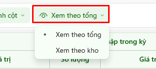

# Kho tồn

## <mark style="color:$primary;">**Màn hình chức năng**</mark>

<figure><figcaption></figcaption></figure>

## <mark style="color:$primary;">Nhóm chức năng tồn kho</mark>

### 1. Giới thiệu chức năng tồn kho

\- Chức năng **Tồn kho** được sử dụng để theo dõi và quản lý tình hình nhập, xuất và tồn của vật tư, hàng hóa, thành phẩm trong doanh nghiệp.

\- Thông qua chức năng này, có thể tra cứu số lượng và giá trị hàng tồn kho tại một thời điểm hoặc trong một khoảng thời gian nhất định. Đồng thời, hệ thống cung cấp thông tin về số lượng giá trị tồn đầu kỳ, nhập trong kỳ, xuất trong kỳ và tồn cuối kỳ của từng mặt hàng.

\- Chức năng giúp kế toán và người quản lý dễ dàng kiểm tra tình hình hàng hóa trong kho, theo dõi biến động nhập xuất và đối chiếu số liệu tồn kho phục vụ công tác kế toán.

### 2. Các chức năng trong màn hình tồn kho

\- Thoát về màn hình chính (**Tổng quan**) (<mark style="color:red;">**Phím tắt ESC**</mark>)

#### Nhóm chức năng **Thao tác**: (<mark style="color:red;">**Phím tắt F1**</mark>)

<figure><figcaption></figcaption></figure>

\+ Danh mục kho: Mở danh mục kho, tại đây có thể thêm, sửa thông tin kho, nơi quản lý tất cả các kho trong doanh nghiệp.

\+ Danh mục vật tư, hàng hóa, thành phẩm: Mở màn hình danh mục quản lý vật tư, hàng hóa, thành phẩm, có thể thêm, xóa, sửa thông tin các vật phẩm hàng hóa.

\+ Chứng từ kho: Mở chức năng chứng từ, theo dõi danh sách chứng từ đã nhập vào hệ thống.

\+ Sắp xếp (<mark style="color:red;">**Phím tắt Alt + S**</mark>): Cho phép thay đổi thứ tự hiển thị dữ liệu trên danh sách theo một hoặc nhiều tiêu chí, giúp dễ dàng tra cứu, kiểm tra và đối chiếu.

<figure><figcaption></figcaption></figure>

\+ Lọc (Phím tắt Alt +L): Cho phép lọc và hiển thị các dữ liệu đáp ứng một hoặc nhiều điều kiện lọc, giúp nhanh chóng tra cứu thông tin cần thiết trên danh sách.

<figure><figcaption></figcaption></figure>

\+ Chỉnh cột hiển thị (<mark style="color:red;">**Phím tắt Alt + D**</mark>): cho phép tùy chỉnh cách hiển thị các cột dữ liệu trên màn hình danh sách, bao gồm sắp xếp thứ tự cột và ẩn/hiện cột theo nhu cầu sử dụng.

<figure><figcaption></figcaption></figure>

\+ Xem theo tổng (<mark style="color:red;">**Phím tắt Alt + V**</mark>): Cho phép thay đổi cách hiển thị danh sách dữ liệu trên màn hình. Tùy theo nhu cầu làm việc , ngoài ra có thể lựa chọn hiển thị thông tin ở dạng rút gọn hoặc đầy đủ, đồng thời bật/tắt khung xem trước để theo dõi nội dung nhanh hơn.

<figure><figcaption></figcaption></figure>

#### Nhóm chức năng **Xử lý**: (<mark style="color:red;">**Phím tắt F2**</mark>)

<figure><figcaption></figcaption></figure>

\+ Nhập kho: Chuyển đến màn hình tạo mới chứng từ và lập phiếu hạch toán chứng từ nhập kho.

\+ Xuất kho: Chuyển đến màn hình tạo mới chứng từ và lập phiếu hạch toán chứng từ xuất kho.

\+ Chuyển kho: Chuyển đến màn hình tạo mới chứng từ và lập phiếu hạch toán chứng từ chuyển kho.

\+ Tồn khi đầu kỳ: mở chức năng tồn kho đầu kỳ, hiển thị màn hình chức năng tồn kho đầu kỳ.

\+ Kiểm kê: mở chức năng kiểm kê kho, hiển thị màn hình chức năng kiểm kê kho.

#### Nhóm chức năng Kết xuất: (<mark style="color:red;">**Phím tắt Ctrl + P**</mark>)

<figure><figcaption></figcaption></figure>

\+ Xuất file (<mark style="color:red;">**Phím tắt Alt + E**</mark>): xuất danh sách chứng từ ra file excel.

\+ In nhập xuất tồn (<mark style="color:red;">**Phím tắt Alt + I**</mark>): Mở màn hình bảng báo cáo nhập xuất tồn.

\+ Báo cáo kho (<mark style="color:red;">**Phím tắt Alt + B**</mark>): Hiển thị danh sách các loại báo cáo liên quan tới kho. Bấm vào các loại báo cáo để chuyển tới màn hình báo cáo đó.

<figure><figcaption></figcaption></figure>

\- Tìm kiếm (<mark style="color:red;">**Phím tắt Ctrl + F**</mark>): thực hiện tìm kiếm theo nội dung nhập vào để tìm kiếm nhanh.

\- Chọn thời gian hiển thị (<mark style="color:red;">**Phím tắt Ctrl + T**</mark>): chọn thời gian hiển thị tương ứng.

\- Làm mới dữ liệu (<mark style="color:red;">**Phím tắt F5**</mark>): làm mới lại các nội dung hiển thị trên màn hình.

### &#x20;3. Hướng dẫn sử dụng chức năng tồn kho



#### Bước 1: Truy cập chức năng

Tại thanh menu bên trái màn hình, chọn Kho để mở màn hình theo dõi tồn kho.



#### Bước 2: Chọn thời điểm xem tồn kho

Tại khu vực Tồn đến ngày (<mark style="color:red;">**Phím tắt Alt + T**</mark>) chọn ngày cần xem số liệu tồn kho.



#### Bước 3: Tìm kiếm hàng hóa

Nhập mã hàng hoặc tên hàng vào ô tìm kiếm để nhanh chóng tìm được mặt hàng cần tra cứu.




#### Bước 4: Lọc và tùy chỉnh dữ liệu

* Sử dụng chức năng **Lọc** (<mark style="color:red;">**Phím tắt Alt + L**</mark>) để giới hạn danh sách theo điều kiện mong muốn.
* Sử dụng **Sắp xếp** (<mark style="color:red;">**Phím tắt Alt + S**</mark>) để thay đổi thứ tự hiển thị.
* Sử dụng **Chỉnh cột** (<mark style="color:red;">**Phím tắt Alt+ D**</mark>) để tùy chỉnh các thông tin cần theo dõi.
* Sử dụng **Xem** (<mark style="color:red;">**Phím tắt + V**</mark>) theo tháng để theo dõi dữ liệu theo từng tháng.



#### Bước 5: Kiểm tra số liệu tồn kho

Theo dõi các thông tin tồn đầu kỳ, nhập trong kỳ, xuất trong kỳ và tồn cuối kỳ để kiểm tra tình hình hàng hóa trong khi.




<mark style="color:$danger;">**Lưu ý khi sử dụng:**</mark>

* <mark style="color:$danger;">Số liệu tồn kho được tổng hợp dựa trên các nghiệp vụ và chứng từ kho đã được ghi nhận trên hệ thống.</mark>
* <mark style="color:$danger;">Cần kiểm tra các chứng từ nhập kho, xuất kho và điều chuyển kho để đảm bảo số liệu được cập nhật chính xác.</mark>
* <mark style="color:$danger;">Khi phát hiện số lượng hoặc giá trị tồn kho chưa chính xác, cần kiểm tra lại chứng từ phát sinh và quá trình xử lý dữ liệu kho.</mark>
* <mark style="color:$danger;">Số lượng và giá trị tồn kho là hai thông tin riêng biệt, cần kiểm tra cả hai khi đối chiếu số liệu.</mark>

